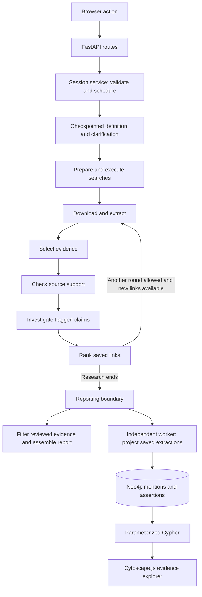

# Architecture and code-reading guide

This guide is for developers reviewing how ProjectClarity turns a question into a
source-linked answer and an explorable knowledge graph. For the product overview and installation, start with the
[main README](README.md).

## A focused reading tour

1. [research_graph.py](src/projectclarity/workflow/research_graph.py) — the workflow,
   its branches, and the conditions that allow or stop each transition.
2. [research_sessions.py](src/projectclarity/workflow/research_sessions.py) — durable
   session state, action eligibility, worker scheduling, and explicit recovery.
3. [document_pipeline.py](src/projectclarity/documents/document_pipeline.py) — how
   supplied URLs become saved documents, extraction receipts, and usable facts.
4. [research_rounds.py](src/projectclarity/workflow/research_rounds.py) — how selected
   links start another round without losing earlier reviewed evidence.
5. [item_reporting.py](src/projectclarity/reporting/item_reporting.py) — how bounded
   model assessments feed a final report assembled by code.

6. [evidence_projection.py](src/projectclarity/knowledge_graph/evidence_projection.py)
   and [neo4j_store.py](src/projectclarity/knowledge_graph/neo4j_store.py) — how saved
   extraction records become source-linked nodes and Cypher results.
7. [projection_jobs.py](src/projectclarity/knowledge_graph/projection_jobs.py) — why
   graph preparation neither blocks nor supplies report generation.

## Execution model



Here, **LangGraph workflow graphs** describe control flow. The **Neo4j knowledge
graph** stores evidence; it is not a workflow engine or a report input.

There are five graph builders in `research_graph.py`, not one fully checkpointed
workflow:

| Graph | Responsibility |
|---|---|
| Setup | Define answer requirements; pause for clarification and refine the definition. |
| Search preparation | Produce the requested 1–10 queries (default 2) from finalized requirements. |
| Autonomous research | Route collection, review, link exploration, and reporting; stop on failure or cancellation. |
| Document processing | Download and extract from explicitly supplied paths, independently of search. |
| Standalone source collection | Connect search to document processing without downstream review or reporting. |

Setup and search preparation use SQLite-backed checkpoints. The autonomous
research graph is **not crash-checkpointed**: saved artifacts support explicit,
stage-specific recovery, not automatic replay of uncertain model calls.

The session service schedules research workflow work on a serialized executor.
A separate executor owns knowledge-graph projection jobs. Within a stage,
bounded worker pools run independent model calls concurrently. These are separate
controls: concurrency bounds simultaneous work; `model_access/research_budget.py`
shares one request/token allowance across the whole session. Neither is a provider
rate limit or monetary cap. Budget pauses hold workers without replay; Continue
extends allowances explicitly, and Quit releases waits through cancellation.
The session service currently uses FastAPI exceptions for rejected actions; it is
not a framework-independent domain layer.

## Responsibility map

Each package README describes its inputs, outputs, and important boundaries.

| Package | Owns | Does not own |
|---|---|---|
| [ux](src/projectclarity/ux/README.md) | HTTP routes, pages, progress, explicit user actions | Research decisions or background stage order |
| [workflow](src/projectclarity/workflow/README.md) | Graph routing, sessions, round transitions | Whether a claim is supported |
| [question_definition](src/projectclarity/question_definition/README.md) | Required answer fields | Document discovery or reporting |
| [search](src/projectclarity/search/README.md) | Prepared query execution and candidate URLs | Source-document downloading |
| [documents](src/projectclarity/documents/README.md) | Input pool, acquisition, parsing, extraction scheduling | Search strategy or relevance decisions |
| [knowledge_extraction](src/projectclarity/knowledge_extraction/README.md) | Structured facts, quote checks, bounded repair | Independent factual verification |
| [knowledge_graph](src/projectclarity/knowledge_graph/README.md) | Saved-evidence projection, Neo4j persistence and collection-scoped Cypher | Report inputs, identity resolution or independent verification |
| [evidence_selection](src/projectclarity/evidence_selection/README.md) | Selecting potentially relevant original facts | Rewriting facts or proving completeness |
| [claim_review](src/projectclarity/claim_review/README.md) | Support review and saved-passage investigation | New web research during a claim review |
| [link_ranking](src/projectclarity/link_ranking/README.md) | Bounded shortlisting, ratings, selected destinations | Fetching destinations itself |
| [reporting](src/projectclarity/reporting/README.md) | Bounded evidence filtering, item assembly, citations, CSV | Collecting missing evidence |
| [model_access](src/projectclarity/model_access/README.md) | Provider calls, receipts, usage accounting, run-wide budgets | Stage routing, provider pricing or rate limits |
| [prompts](src/projectclarity/prompts/README.md) | Task instructions loaded by application code | Workflow control |

## Follow a request

1. `web_app.create_app` sends a browser action to `Sessions`.
2. The service checks eligibility, saves state, and schedules work. Reading a page
   or polling progress does not queue research.
3. Definition and clarification establish the question and requested answer fields.
   Query preparation then hands off to the autonomous research graph.
4. Stage workers save artifacts and publish progress. The graph continues only
   after eligible outcomes and when no stop has been requested.
5. After the round checkpoint and eligible link ranking, the workflow either starts
   another document round or enters reporting. At a fresh reporting boundary it
   queues graph preparation independently. Later rounds use selected URLs, not
   another search. Report-only retries do not queue another graph projection.
6. The browser follows the saved current stage and round. Read-only saved views
   remain available without restarting work.

## Follow a fact

```text
Source bytes → parsed text → extraction + validation/repair receipt → knowledge.json
  ├─ Report path: relevant_knowledge.json → triage decisions
  │    → investigation report_knowledge.json → cumulative reviewed evidence
  │    → bounded answer contributions → report.json + report.csv
  └─ Graph path: accepted extraction records across retained rounds
       → source-linked mentions/assertions → Neo4j → Cypher → browser explorer
```

Source quotations and record references survive selection and review. Unreviewed
or rejected claims are not silently promoted into the report store. Multi-round
report inputs retain original fact IDs, source-run references, round-qualified
IDs, input hashes, and coverage for each round. Earlier stores remain unchanged.

Follow `artifact_directory` references rather than assuming a single global file:
several stage attempts can contain files with the same name. An **attempt** is one
stage execution; a **receipt** records a request, response, or decision; a
**manifest** records inputs and hashes. A **bucket** is a saved collection of
records, not a separate database. A hash detects changes, not factual confidence.

## Concurrency, limits, and recovery

All six model-processing stages have independent concurrency settings (default 6,
range 1–16). Workers handle isolated units; coordinators serialize shared progress
and preserve deterministic result order. Stop prevents new dispatch and retains
responses from already-started calls. Recovery is explicit and stage-specific:

- Selection, triage, and investigation have guarded resume paths with context and
  saved-response checks; eligibility differs by stage.
- During extraction, `adaptive_chunk_sizing.py` adjusts each document's pending
  spans on a 3,000 / 1,500 / 750 / 325 character ladder. Confirmed output truncation
  splits downward; two clean replies below 60% output permit a one-level promotion.
  Failed parents remain auditable, successful leaves retain exact source offsets,
  and all new calls use the ordinary concurrency and run-wide budget gates.
  Investigation uses offset-adjacent leaf passages, not consecutive numeric IDs.
- A document retry is a new retained attempt. A linked round retries its saved
  destinations rather than replaying first-round search.
- Ranking retries can reuse matching validated batches.
- Report retry enters reporting directly, using saved reviewed evidence. It does
  not rerun search, extraction, claim review, or completed ranking.

Rounds default to 2, with a total limit of 1–5. Each additional round follows up to
10 selected destinations, at most 3 from one source page. Before ranking, usage
over half of either current budget pauses for an explicit next-round choice; the
final round skips ranking at that threshold. See the
[workflow policy](src/projectclarity/workflow/README.md) for exclusions and limits.

## Reporting design

The current item-first path uses `answer_item_selection.py`, `item_reporting.py`,
and `answer_item_assembly.py`. The model filters bounded evidence batches into
cited answer contributions; code combines compatible exact-label items and retains
missing or conflicting fields. There is **no model merge or narrative-writing
step** in this path.

The shared dispatcher performs provider token-count preflight, records raw replies,
and revalidates eligible saved tasks on retry. Final validation checks required
fields and citations. Complete reports account for every input; partial item reports
explicitly list unreviewed facts rather than invent exclusions. Invalid fields are
withheld, successful batches survive failures, and retries reuse valid siblings. Historical narrative/merge code
remains for explicit legacy regression fixtures; it is not the default workflow.
See [reporting contracts](src/projectclarity/reporting/README.md).

## Verification and extension points

Use the [test guide](tests/README.md) for commands and representative regressions.
The HTTP workflow and research-round tests exercise real graph routing with only
external I/O replaced. Tests of legacy reporting do not establish current item
report quality. Standalone experiments live in [testing](testing/README.md).

When extending the project:

- Keep downstream routing in the graph and business decisions out of browser code.
- Preserve original evidence and record why a fact is selected, rejected, or unreviewed.
- Document functions with purpose, `Args`, `Returns`, relevant side effects, and failures.
- Treat prompt text and Pydantic schema descriptions as model-facing behavior.
- Test the real entry point for routing or recovery changes, not only helper functions.
- Keep generated `runs/` data, credentials, and dependencies out of source exports.

Quote matching proves text presence, not truth. Source-support review is not
independent corroboration. Tests establish execution contracts, not general model
accuracy. Exact-label assembly is not universal entity resolution, and bounded
exploration does not establish exhaustive answer coverage.

## Knowledge graph architecture

The [knowledge graph package](src/projectclarity/knowledge_graph/README.md) converts
accepted, indexed extraction records from retained research rounds into a rebuildable
Neo4j view. This includes assertions not selected for the report; later claim-review
decisions are not currently overlaid. Original saved source and extraction files
remain authoritative.

### Storage and ownership

| Store | Owner and purpose | Boundary |
|---|---|---|
| Source files, extraction receipts and `knowledge.json` | Document/extraction pipeline; source bytes, quotes, accepted records and artifact hashes | Projection reads these without rewriting them |
| Reviewed evidence and report files | Selection/review/reporting; report eligibility, citations and output | Report does not read Neo4j |
| `collections.json` | Collection service; persistent grouping and default collection | Logical separation, not multi-user authorization |
| `knowledge-graph.json` per session | `ProjectionJobs`; queued/running/completed/failed/interrupted status | Separate from research/report progress |
| Neo4j | `Neo4jStore`; derived mention/assertion nodes and relationships | Rebuildable; not a replacement for saved evidence |

An entity is a source-scoped `ClarityMention`. A `ClarityAssertion` retains the
predicate, statement, literal value, quotation, URL, research round and extraction
lineage. Connections are `Mention -[:SUBJECT_OF]-> Assertion -[:OBJECT]-> Mention`;
a literal attribute may have no object node. Names alone never merge identities.

`evidence_rows` validates indexed artifact hashes and prepares records.
`Collections.sync` scopes them to the session's collection. `Neo4jStore.replace_session`
atomically replaces that session's projection while preserving other sessions;
failure rolls back. Repeated projection does not accumulate duplicate records.
New sessions share one persistent default collection. The current explorer queries
that collection across sessions, including when reached from a report; the internal
collection query API also supports a session filter.

### Independent execution and browser delivery

At the reporting boundary, `research_graph.report` queues `ProjectionJobs` with a
frozen session snapshot and immediately proceeds to report generation. Graph jobs
have their own executor and progress receipts. `Sessions.read` exposes that progress
without letting report updates overwrite it. A slow or failed graph never blocks
the report, and a fast report may finish first.

`graph_routes.py` exposes graph reads and explicit refresh. Fixed, parameterized
Cypher retrieves bounded assertions and endpoints; the browser cannot supply arbitrary
Cypher. `knowledge_graph.js` renders those rows with vendored Cytoscape.js and connects
selection to the evidence inspector. Default/max assertion limits are 250/500, ordered
by stable record ID rather than relevance. The ready notice offers navigation but
never opens the explorer automatically.

Refresh uses saved records, not new search/download/model calls, and can run during
reporting. Interrupted graph jobs are marked interrupted on restart, not silently
replayed. Report retries do not rebuild the graph. Refreshing an older saved session
can recreate its projection after graph-only deletion; deleting Neo4j data is not
deleting the original research.

The omission-review step belongs to extraction, not the graph renderer. It can add
missing object references while retaining originals; it does not resolve identities,
repair all multi-entity assertions, or establish semantic truth. See the
[extraction contract](src/projectclarity/knowledge_extraction/README.md#targeted-entity-omission-review).

Configure Neo4j separately using the [setup guide](docs/KNOWLEDGE_GRAPH.md). Tests in
[test_knowledge_graph.py](tests/integration/test_knowledge_graph.py) cover collection
isolation, source lineage, persistence and independence from reporting. Real-database
checks need an explicit development connection; offline fixtures do not prove live
model quality or production database availability.

## Initial search and human verification

The question form also saves `web_query_count` (default 2, range 1–10). It reaches
the query-planning prompt, exact-count validation, saved search receipts and initial
search execution. Each query still requests at most five results. Later research
rounds follow selected links; each failed or empty initial query advances through Mwmbl, Bing RSS and Wikipedia,
stopping at the first usable result set and saving every attempt.

### Human search verification

The web session binds `SearchExecution.on_challenge` to its in-memory
`CaptchaHandoff`. `search_web` keeps the credential-free subprocess alive while
`duckduckgo_session.search_session` retains the HTTP client. Private temporary
files carry only raster images/instructions and explicit human decisions between
processes; cookies and provider form tokens stay inside the worker. The parent
suspends the active-request timeout during the human wait but still honors stop.
The one-use session-bound API rejects stale decisions. A successful answer is not
counted as search success until actual result URLs are parsed. Skip proceeds to
the normal provider chain; cancellation and application shutdown terminate the
worker. No model call is made to interpret challenge images.
