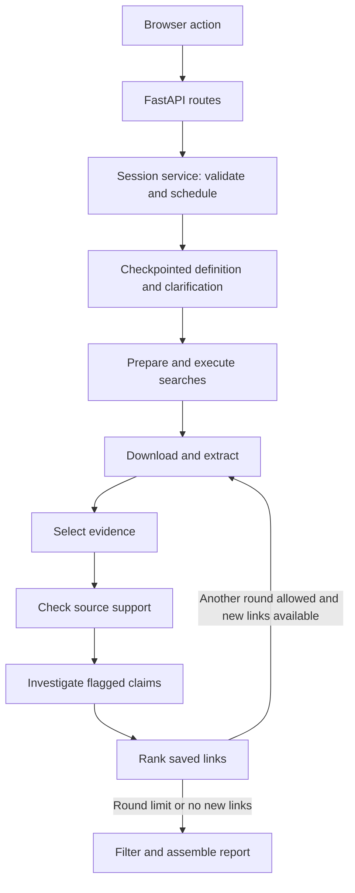

# Architecture and code-reading guide

This guide is for developers reviewing how ProjectClarity turns a question into a
source-linked answer. For the product overview and installation, start with the
[main README](README.md).

## A five-file reading tour

1. [research_graph.py](src/projectclarity/workflow/research_graph.py) — the workflow,
   its branches, and the conditions that allow or stop each transition.
2. [research_sessions.py](src/projectclarity/workflow/research_sessions.py) — durable
   session state, action eligibility, worker scheduling, and explicit recovery.
3. [document_pipeline.py](src/projectclarity/documents/document_pipeline.py) — how
   supplied URLs become saved documents, extraction receipts, and usable facts.
4. [research_rounds.py](src/projectclarity/workflow/research_rounds.py) — how selected
   links start another round without losing earlier reviewed evidence.
5. [item_reporting.py](src/projectclarity/reporting/item_reporting.py) — how bounded
   model assessments feed a final report assembled by code.

## Execution model



There are five graph builders in `research_graph.py`, not one fully checkpointed
workflow:

| Graph | Responsibility |
|---|---|
| Setup | Define answer requirements; pause for clarification and refine the definition. |
| Search preparation | Produce two queries from the finalized requirements. |
| Autonomous research | Route collection, review, link exploration, and reporting; stop on failure or cancellation. |
| Document processing | Download and extract from explicitly supplied paths, independently of search. |
| Standalone source collection | Connect search to document processing without downstream review or reporting. |

Setup and search preparation use SQLite-backed checkpoints. The autonomous
research graph is **not crash-checkpointed**: saved artifacts support explicit,
stage-specific recovery, not automatic replay of uncertain model calls.

The session service schedules graph work on a serialized executor. Within a stage,
bounded worker pools run independent model calls concurrently. These are separate
controls: a concurrency setting is not a global spending or provider-rate limit.
The session service currently uses FastAPI exceptions for rejected actions; it is
not a framework-independent domain layer.

## Responsibility map

Each package README describes its inputs, outputs, and important boundaries.

| Package | Owns | Does not own |
|---|---|---|
| [ux](src/projectclarity/ux/README.md) | HTTP routes, pages, progress, explicit user actions | Research decisions or background stage order |
| [workflow](src/projectclarity/workflow/README.md) | Graph routing, sessions, round transitions | Whether a claim is supported |
| [question_definition](src/projectclarity/question_definition/README.md) | Required answer fields | Document discovery or reporting |
| [search](src/projectclarity/search/README.md) | Prepared query execution and candidate URLs | Source-document downloading |
| [documents](src/projectclarity/documents/README.md) | Input pool, acquisition, parsing, extraction scheduling | Search strategy or relevance decisions |
| [knowledge_extraction](src/projectclarity/knowledge_extraction/README.md) | Structured facts, quote checks, bounded repair | Independent factual verification |
| [evidence_selection](src/projectclarity/evidence_selection/README.md) | Selecting potentially relevant original facts | Rewriting facts or proving completeness |
| [claim_review](src/projectclarity/claim_review/README.md) | Support review and saved-passage investigation | New web research during a claim review |
| [link_ranking](src/projectclarity/link_ranking/README.md) | Bounded shortlisting, ratings, selected destinations | Fetching destinations itself |
| [reporting](src/projectclarity/reporting/README.md) | Bounded evidence filtering, item assembly, citations, CSV | Collecting missing evidence |
| [model_access](src/projectclarity/model_access/README.md) | Provider calls, receipts, usage accounting | Stage routing or a spending cap |
| [prompts](src/projectclarity/prompts/README.md) | Task instructions loaded by application code | Workflow control |

## Follow a request

1. `web_app.create_app` sends a browser action to `Sessions`.
2. The service checks eligibility, saves state, and schedules work. Reading a page
   or polling progress does not queue research.
3. Definition and clarification establish the question and requested answer fields.
   Query preparation then hands off to the autonomous research graph.
4. Stage workers save artifacts and publish progress. The graph continues only
   after eligible outcomes and when no stop has been requested.
5. After link ranking, the graph either starts another document round or reports.
   Later rounds use selected URLs, not another search.
6. The browser follows the saved current stage and round. Read-only saved views
   remain available without restarting work.

## Follow a fact

```text
Source bytes → parsed text → extraction receipt → knowledge.json
  → relevant_knowledge.json → triage decisions
  → investigation report_knowledge.json
  → cumulative reviewed evidence, when multiple rounds exist
  → bounded answer contributions → report.json + report.csv
```

Source quotations and record references survive selection and review. Unreviewed
or rejected claims are not silently promoted into the report store. Multi-round
report inputs retain original fact IDs, source-run references, round-qualified
IDs, input hashes, and coverage for each round. Earlier stores remain unchanged.

Follow `artifact_directory` references rather than assuming a single global file:
several stage attempts can contain files with the same name. An **attempt** is one
stage execution; a **receipt** records a request, response, or decision; a
**manifest** records inputs and hashes. A **bucket** is a saved collection of
records, not a separate database. A hash detects changes, not factual confidence.

## Concurrency, limits, and recovery

All six model-processing stages have independent concurrency settings (default 6,
range 1–16). Workers handle isolated units; coordinators serialize shared progress
and preserve deterministic result order. Stop prevents new dispatch and retains
responses from already-started calls. Recovery is explicit and stage-specific:

- Selection, triage, and investigation have guarded resume paths with context and
  saved-response checks; eligibility differs by stage.
- A document retry is a new retained attempt. A linked round retries its saved
  destinations rather than replaying first-round search.
- Ranking retries can reuse matching validated batches.
- Report retry enters reporting directly, using saved reviewed evidence. It does
  not rerun search, extraction, claim review, or completed ranking.

Rounds default to 2, with a total limit of 1–5. Each additional round follows up to
10 selected destinations, at most 3 from one source page. See the
[workflow policy](src/projectclarity/workflow/README.md) for exclusions and limits.

## Reporting design

The current item-first path uses `answer_item_selection.py`, `item_reporting.py`,
and `answer_item_assembly.py`. The model filters bounded evidence batches into
cited answer contributions; code combines compatible exact-label items and retains
missing or conflicting fields. There is **no model merge or narrative-writing
step** in this path.

The shared dispatcher performs provider token-count preflight, records raw replies,
and revalidates eligible saved tasks on retry. Final validation checks required
fields, citations, and full input accounting. Historical narrative/merge code
remains for explicit legacy regression fixtures; it is not the default workflow.
See [reporting contracts](src/projectclarity/reporting/README.md).

## Verification and extension points

Use the [test guide](tests/README.md) for commands and representative regressions.
The HTTP workflow and research-round tests exercise real graph routing with only
external I/O replaced. Tests of legacy reporting do not establish current item
report quality. Standalone experiments live in [testing](testing/README.md).

When extending the project:

- Keep downstream routing in the graph and business decisions out of browser code.
- Preserve original evidence and record why a fact is selected, rejected, or unreviewed.
- Document functions with purpose, `Args`, `Returns`, relevant side effects, and failures.
- Treat prompt text and Pydantic schema descriptions as model-facing behavior.
- Test the real entry point for routing or recovery changes, not only helper functions.
- Keep generated `runs/` data, credentials, and dependencies out of source exports.

Quote matching proves text presence, not truth. Source-support review is not
independent corroboration. Tests establish execution contracts, not general model
accuracy. Exact-label assembly is not universal entity resolution, and bounded
exploration does not establish exhaustive answer coverage.
