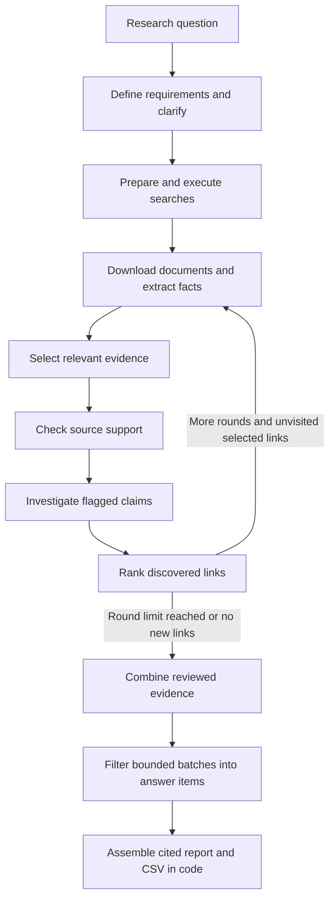

# ProjectClarity

**Agentic research with inspectable evidence—from a question to a cited, structured answer.**

ProjectClarity turns an open-ended research question into explicit answer requirements,
searches the web, extracts facts from documents, reviews their source support, and
follows promising links for additional research. It combines the reviewed evidence
into a report you can inspect and export as CSV.

The engineering focus is **controlled autonomy**: models interpret questions and
assess evidence; code controls execution, validates references, bounds requests,
preserves provenance, and assembles the final answer.

**Stack:** Python · LangGraph · Anthropic API · Pydantic · FastAPI · SQLite · JavaScript

[Architecture & code guide](CODE_GUIDE.md) · [Run locally](#run-locally) · [Tests](#testing)

## What it does

Ask a question such as **“Which Canadian startups build AI products?”** The application:

- Defines the information needed to answer it and asks for clarification when needed.
- Searches for sources, reads HTML and text-bearing PDFs, and extracts facts with quotations.
- Selects relevant evidence, checks source support, and investigates flagged claims using saved passages.
- Ranks discovered links by source contribution and link text, then explores selected destinations in further rounds.
- Produces a cited item table, retaining partial answers and missing information rather than hiding them.

The browser shows stage progress, research rounds, source outcomes, and recorded
model usage. You can stop work, inspect saved results, and retry a failed report
without repeating collection and review.

## Architecture



This is a **bounded, graph-orchestrated agentic workflow**, not an unrestricted
agent loop. LangGraph owns stage transitions and failure gates; HTTP routes serve
the interface and schedule work. Setup uses SQLite-backed checkpoints for human
clarification. Research stages retain source files, model responses, and decisions
so their results can be traced and eligible work reused on explicit retry.

### Engineering highlights

| Challenge | Design decision | Code to explore |
|---|---|---|
| Keep autonomous work predictable | Explicit stage transitions, cancellation gates, and a configurable round limit | [Workflow graph](src/projectclarity/workflow/research_graph.py) |
| Preserve evidence through multiple rounds | Immutable source artifacts, source quotations, round-qualified fact IDs, and cumulative reviewed evidence | [Research rounds](src/projectclarity/workflow/research_rounds.py) |
| Reduce latency without losing recovery | Bounded per-stage worker pools; coordinators save shared progress and retain completed responses when stopped | [Concurrent extraction](src/projectclarity/knowledge_extraction/concurrent_extraction.py) |
| Handle imperfect model responses | Structured checks, fact-level repair, and bounded adaptive extraction when output is truncated | [Fact validation and repair](src/projectclarity/knowledge_extraction/fact_validation_and_repair.py) |
| Prevent oversized report requests | Provider token-count preflight, bounded evidence batches, and deterministic item assembly instead of model merge calls | [Item reporting](src/projectclarity/reporting/item_reporting.py) · [Item assembly](src/projectclarity/reporting/answer_item_assembly.py) |
| Make failures diagnosable | Saved request/response receipts, validation outcomes, token accounting, and explicit retry without automatic crash replay | [Model ledger](src/projectclarity/model_access/model_ledger.py) · [Session management](src/projectclarity/workflow/research_sessions.py) |

See the [code guide](CODE_GUIDE.md) for the complete module map and design boundaries.
Application modules are grouped by responsibility under `src/projectclarity/`;
UI pages, scripts, and styles are separate from research logic.

## Run locally

**Requirements:** Python 3.12+ (tested on 3.12), an Anthropic API key with access to
the configured model, and internet access for live research. The commands below
use a Unix-style shell and should be run from the project root.

```bash
python3 -m venv .venv
.venv/bin/python -m pip install -e .
```

Create a private `.env` file containing:

```dotenv
ANTHROPIC_API_KEY=your_api_key_here
```

Then start the application:

```bash
chmod 600 .env
.venv/bin/projectclarity --port 8775 --env-file .env
```

Open **http://127.0.0.1:8775/**, enter a question, and expand **Settings** if you
want to change the research limits. Answer any clarification questions; the
workflow then proceeds through research and reporting.

| Setting | Default | Range / behavior |
|---|---|---|
| Model request budget | 750 | Shared across setup, all stages, rounds and retries; pauses for Quit or Continue |
| Model token budget | 8,000,000 | Input + output + cache tokens; pending calls reserve room before dispatch |
| Research rounds | 2 | 1–5 total rounds, including the initial search |
| Concurrent model calls | 6 per stage | 1–16 independently for extraction, selection, triage, investigation, link ranking, and report selection |
| Links followed per additional round | Up to 10 | At most 3 from the same source page; previously visited destinations are excluded |

An `ANTHROPIC_API_KEY` environment variable takes precedence over the file.
The current model is configured in [model_client.py](src/projectclarity/model_access/model_client.py).
Live model calls can incur charges. Request/token budgets are usage limits, not
monetary caps. **Continue** adds another configured allowance without replaying
completed work. Provider token estimates may differ from actual usage; unconfirmed
usage is displayed explicitly and requires acknowledgement before more calls.

Saved data defaults to `runs/web/` relative to the launch directory; use
`--data-dir /path/to/private-data` to change it. Keep `.env`, `.venv/`, and private
run artifacts out of source-code exports. This is a **local application**, not an
authenticated public service.

## Testing

The latest verified suite contains **149 passing automated tests**. Run it without
model credentials or live service calls:

```bash
.venv/bin/python -m unittest discover -s tests -t . -q
```

Tests replace external search, downloads, and model responses with deterministic
fixtures while exercising the real application and workflow. Coverage includes:

- HTTP-to-graph execution and checkpointed clarification.
- Robots rules, document parsing, extraction recovery, and evidence references.
- Concurrent processing, cooperative stopping, and saved-response reuse.
- Multi-round exploration, duplicate destinations, and cumulative report evidence.
- Report-only retry, input preservation, and bounded report preparation.

Start with the [end-to-end workflow tests](tests/integration/test_research_graph.py)
and [research-round tests](tests/integration/test_research_rounds.py).
Node.js enables the JavaScript status-indicator checks; those checks are skipped
when it is unavailable. See [test documentation](tests/README.md) for details and
[developer experiments](testing/README.md) for extraction and reporting probes.
The test command is CI-ready; hosted CI/CD is not configured.

## Current boundaries

- **Source support is not independent truth.** Citation and schema checks do not
  establish that a source is correct or that the model interpreted it correctly.
- **Exploration is bounded, not exhaustive.** Research stops at the configured
  round limit or when no unvisited selected links remain—not when completeness is proven.
- **Partial candidates remain visible.** Missing fields stay explicit. Exact-label
  assembly does not resolve every alias or duplicate company identity.
- **Review is round-local.** Later evidence joins the report but does not reopen
  earlier rejected claims automatically.
- **Recovery is deliberate.** A server restart does not replay model calls.
  Explicit retries can reuse matching saved responses; unfinished work may need new calls.

Offline tests establish workflow behavior and validation contracts, not general
research accuracy. Detailed policies live with the implementation:
[rounds and recovery](src/projectclarity/workflow/README.md),
[link ranking](src/projectclarity/link_ranking/README.md), and
[reporting](src/projectclarity/reporting/README.md).

## License

[MIT](LICENSE), retaining the existing ProjectClarity copyright notice.

An optional [systemd user-service example](deployment/README.md) is provided for
running the local application in the background.
