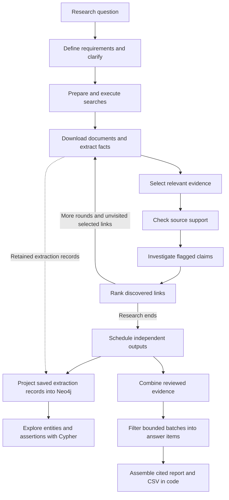

# ProjectClarity

**Agentic research with inspectable evidence—from a question to a cited answer and an explorable knowledge graph.**

ProjectClarity is an agentic research system that automates search, reads documents,
and performs entity extraction to build knowledge graphs from unstructured data.

It started about a year ago as an experiment with named entity extraction. Basically
just testing to see how useful an LLM would be at identifying people and places within
documents. This seemingly simple task was very difficult a few years ago, and now it's
become mostly trivial.

This version uses LangGraph to manage an agentic workflow. The workflow allows you to
start with an open-ended research question. From there the system derives explicit answer
requirements (basically, what information is needed as part of formulating an answer to
the supplied question), automates web search (you might have to answer a captcha), extracts
facts from documents, reviews their source support, and follows promising links for additional research.

At the end the system assembles reviewed evidence into a cited report you can export as CSV.

Separately, it builds a knowledge graph from saved extraction records so you can explore entities
and their source-backed relationships, including assertions not selected for the report.
Ultimately (for me) the knowledge graph is the goal, and the research request is a way to focus searching.

The engineering focus is **controlled autonomy**: models interpret questions and
assess evidence; code controls execution, validates references, bounds requests,
preserves provenance, and assembles the final answer.

**Stack:** Python · LangGraph · Anthropic API / Amazon Bedrock · Pydantic · FastAPI · SQLite · Neo4j / Cypher · Cytoscape.js · JavaScript

[Architecture & code guide](CODE_GUIDE.md) · [Run locally](#run-locally) · [Tests](#testing)

## See a real research run

**[Canadian AI startup discovery: case study](docs/case-studies/canadian-ai-startups/README.md)**
— [four-slide presentation](docs/case-studies/canadian-ai-startups/presentation.pdf),
actual application screenshots, and the full cited report. A newer graph example
shows extracted relationships around the University of Toronto and Geoffrey Hinton.

Two rounds retained **1,221 extraction records**, supplied **549 facts to report
evidence**, and produced **49 report rows**. The case study traces a useful
follow-up discovery, measures model usage, and examines duplicates, scope drift
and missing qualifications. It demonstrates collection and assembly for human
review—not an exhaustive or independently verified startup directory. Static
artifacts need no API key.

## What it does

Ask a question such as **“Which Canadian startups build AI products?”** The application:

- Defines the information needed to answer it and asks for clarification when needed.
- Searches for sources, reads HTML and text-bearing PDFs, and extracts facts with quotations.
- Selects relevant evidence, checks source support, and investigates flagged claims using saved passages.
- Ranks discovered links by source contribution and link text, then explores selected destinations in further rounds.
- Builds a persistent Neo4j graph of source-scoped entity mentions and assertions,
  with quotations and source lineage available for inspection.
- Produces a cited item table, retaining partial answers and missing information rather than hiding them.

The browser shows stage progress, research rounds, source outcomes, and recorded
model usage. You can stop work, inspect saved results, and retry a failed report
without repeating collection and review.

## Architecture



This is a **bounded, graph-orchestrated agentic workflow**, not an unrestricted
agent loop. LangGraph owns stage transitions and failure gates; HTTP routes serve
the interface and schedule work. Setup uses SQLite-backed checkpoints for human
clarification. Research stages retain source files, model responses, and decisions
so their results can be traced and eligible work reused on explicit retry.

LangGraph controls **workflow execution**; Neo4j stores the **knowledge graph**.
They are separate graphs with different responsibilities. At the reporting boundary,
graph preparation and report generation run independently. Neither waits for the
other. The report stays in focus; a **Knowledge graph ready — Explore** notice
lets the user open the explorer explicitly.

### Engineering highlights

| Challenge | Design decision | Code to explore |
|---|---|---|
| Keep autonomous work predictable | Explicit stage transitions, cancellation gates, and a configurable round limit | [Workflow graph](src/projectclarity/workflow/research_graph.py) |
| Preserve evidence through multiple rounds | Immutable source artifacts, source quotations, round-qualified fact IDs, and cumulative reviewed evidence | [Research rounds](src/projectclarity/workflow/research_rounds.py) |
| Reduce latency without losing recovery | Bounded per-stage worker pools; coordinators save shared progress and retain completed responses when stopped | [Concurrent extraction](src/projectclarity/knowledge_extraction/concurrent_extraction.py) |
| Handle imperfect model responses | Structured checks, fact-level repair, and bounded adaptive extraction when output is truncated | [Fact validation and repair](src/projectclarity/knowledge_extraction/fact_validation_and_repair.py) |
| Explore knowledge without changing the report | Rebuildable Neo4j projection, parameterized Cypher and an independent graph worker | [Knowledge graph](src/projectclarity/knowledge_graph/README.md) |
| Prevent oversized report requests | Adapter token-count/estimate preflight, bounded evidence batches, and deterministic item assembly instead of model merge calls | [Item reporting](src/projectclarity/reporting/item_reporting.py) · [Item assembly](src/projectclarity/reporting/answer_item_assembly.py) |
| Make failures diagnosable | Saved request/response receipts, validation outcomes, token accounting, and explicit retry without automatic crash replay | [Model ledger](src/projectclarity/model_access/model_ledger.py) · [Session management](src/projectclarity/workflow/research_sessions.py) |

See the [code guide](CODE_GUIDE.md) for the complete module map and design boundaries.
Application modules are grouped by responsibility under `src/projectclarity/`;
UI pages, scripts, and styles are separate from research logic.

## Knowledge beyond the report

The explorer shows entity mentions connected through assertion nodes. Selecting
an assertion highlights its connections and reveals its statement, source quotation
and provenance. Search and zoom help inspect a bounded view—250 assertions by
default, up to 500—not a claim to display all knowledge at once.

Original extraction records remain authoritative. Neo4j is a derived view that can
be rebuilt without new searches or model extraction. New research gets a fresh
knowledge session by default. Expanded Settings let you select an existing ID to
add evidence to that graph deliberately. Explore from a report opens its assigned
knowledge session, including other research explicitly assigned to it. Old graphs
are preserved; the legacy standalone explorer still shows the historical Default.

Matching names are not automatically merged, and later source-support review is
not currently overlaid on graph assertions. The graph is an evidence explorer,
not an independently verified database or a graph-reasoning agent. See the
[graph implementation guide](src/projectclarity/knowledge_graph/README.md) and
[Neo4j setup and validation](docs/KNOWLEDGE_GRAPH.md).

## Run locally

**Requirements:** Python 3.12+ (tested on 3.12), an Anthropic API key or Bedrock API
key with access to the configured model, and internet access for live research. The commands below
use a Unix-style shell and should be run from the project root.

**Backend selection:** Anthropic remains the default. Bedrock Nova Micro is also
available through the shared provider interface. See [model providers](docs/MODEL_PROVIDERS.md)
for configuration, capability differences, verification limits and adding future
providers such as Ollama. Ollama itself is not implemented yet.

```bash
python3 -m venv .venv
.venv/bin/python -m pip install -e .
```

Create a private `.env` file containing:

```dotenv
ANTHROPIC_API_KEY=your_api_key_here
```

For the optional knowledge graph, also install and configure a separate Neo4j
service using the [graph setup guide](docs/KNOWLEDGE_GRAPH.md). Installing the Python
package installs the driver, not the database. Research and reporting remain usable
without Neo4j.

Then start the application:

```bash
chmod 600 .env
.venv/bin/projectclarity --port 8775 --env-file .env
```

Open **http://127.0.0.1:8775/**, enter a question, and expand **Settings** if you
want to change the research limits. Answer any clarification questions; the
workflow then proceeds through research and reporting.

| Setting | Default | Range / behavior |
|---|---|---|
| Model request budget | 750 | Shared across setup, all stages, rounds and retries; pauses for Quit or Continue |
| Model token budget | 8,000,000 | Input + output + cache tokens; pending calls reserve room before dispatch |
| Number of web queries | 2 | 1–10 initial queries, up to 5 results each; later rounds follow links |
| Research rounds | 2 | 1–5 total rounds, including the initial search |
| Concurrent model calls | 6 per stage | 1–16 independently for extraction, selection, triage, investigation, link ranking, and report selection |
| Links followed per additional round | Up to 10 | At most 3 from the same source page; previously visited destinations are excluded |

Process environment settings take precedence over the private `.env` file.
Choose the backend and model with `PROJECTCLARITY_PROVIDER` / `PROJECTCLARITY_MODEL`
or the `--provider` / `--model` CLI overrides; see [model configuration](docs/MODEL_PROVIDERS.md).
Live model calls can incur charges. Request/token budgets are usage limits, not
monetary caps. **Continue** adds another configured allowance without replaying
completed work. Provider token estimates may differ from actual usage; unconfirmed
usage is displayed explicitly and requires acknowledgement before more calls.

Saved data defaults to `runs/web/` relative to the launch directory; use
`--data-dir /path/to/private-data` to change it. Keep `.env`, `.venv/`, and private
run artifacts out of source-code exports. This is a **local application**, not an
authenticated public service.

## Search provider fallback

DuckDuckGo may request human verification. Clarity pauses that search and shows a
CAPTCHA dialog; you can answer it, try the next provider, or cancel research. Search
continues through Mwmbl, Bing RSS and Wikipedia when a provider fails or returns no
usable results. See the [search guide](src/projectclarity/search/README.md).

## Testing

Run the automated suite without model credentials or live research calls:

```bash
.venv/bin/python -m unittest discover -s tests -t . -q
```

Tests replace external search, downloads, and model responses with deterministic
fixtures while exercising the real application and workflow. Coverage includes:

- HTTP-to-graph execution and checkpointed clarification.
- Robots rules, document parsing, extraction recovery, and evidence references.
- Concurrent processing, cooperative stopping, and saved-response reuse.
- Multi-round exploration, duplicate destinations, and cumulative report evidence.
- Report-only retry, input preservation, and bounded report preparation.
- Graph/report independence, saved-evidence projection, collection boundaries and
  source-linked graph queries. Database-dependent checks require an explicitly
  configured development Neo4j instance; see the [graph validation guide](docs/KNOWLEDGE_GRAPH.md#validate).

Start with the [end-to-end workflow tests](tests/integration/test_research_graph.py)
and [research-round tests](tests/integration/test_research_rounds.py).
Node.js enables the JavaScript status-indicator checks; those checks are skipped
when it is unavailable. See [test documentation](tests/README.md) for details and
[developer experiments](testing/README.md) for extraction and reporting probes.
The test command is CI-ready; hosted CI/CD is not configured.

## Current boundaries

- **Source support is not independent truth.** Citation and schema checks do not
  establish that a source is correct or that the model interpreted it correctly.
- **Exploration is bounded, not exhaustive.** Research stops at the configured
  round limit or when no unvisited selected links remain—not when completeness is proven.
- **Partial candidates remain visible.** Missing fields stay explicit. Exact-label
  assembly does not resolve every alias or duplicate company identity.
- **Review is round-local.** Later evidence joins the report but does not reopen
  earlier rejected claims automatically.
- **Recovery is deliberate.** A server restart does not replay model calls.
  Report selection and claim investigation can retry rejected output once within
  the existing budget. Explicit retries can reuse matching saved responses;
  unfinished work may need new calls.

Offline tests establish workflow behavior and validation contracts, not general
research accuracy. Detailed policies live with the implementation:
[rounds and recovery](src/projectclarity/workflow/README.md),
[link ranking](src/projectclarity/link_ranking/README.md), and
[reporting](src/projectclarity/reporting/README.md).

## License

[MIT](LICENSE), retaining the existing ProjectClarity copyright notice.

An optional [systemd user-service example](deployment/README.md) is provided for
running the local application in the background.
