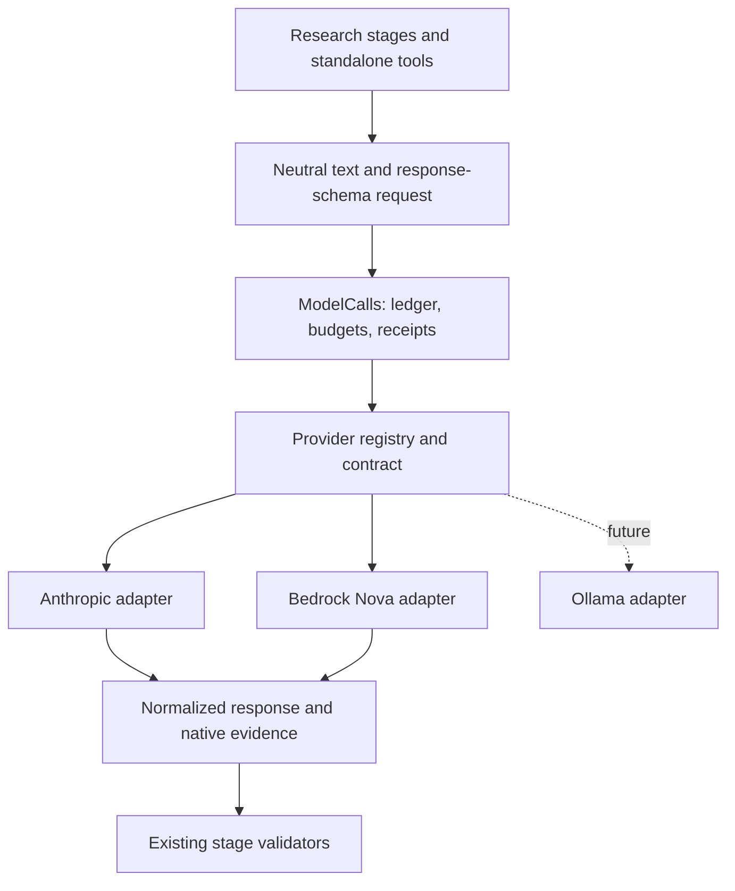

# Model providers

## Acceptance and scope

The production HTTP research workflow must select Anthropic or Bedrock Nova Micro
through the same transport contract, preserve application validation and budget
accounting, and never silently fall back. Adding another provider must require an
adapter and registration, not edits to research stages. A credential-free third
test adapter exercises that extension contract; **Ollama is not implemented yet**.

## Select a backend

In the existing private `.env` file, keep your other settings and set:

```dotenv
PROJECTCLARITY_PROVIDER=bedrock
PROJECTCLARITY_MODEL=us.amazon.nova-micro-v1:0
AWS_REGION=us-east-2
PROJECTCLARITY_BEDROCK_OUTPUT=json_text
AWS_BEARER_TOKEN_BEDROCK=your-key-here
```

Do not commit this file; use `chmod 600 .env`. The short-term Bedrock key still
expires and needs replacement. Credentials are re-read per request; provider and
model selection are fixed for the server lifetime. Restart to switch backends,
and use a new research session for a clean backend comparison.

To return to Anthropic:

```dotenv
PROJECTCLARITY_PROVIDER=anthropic
PROJECTCLARITY_MODEL=claude-haiku-5-5
ANTHROPIC_API_KEY=your-key-here
```

Leave `PROJECTCLARITY_MODEL` blank to use the selected provider's default. Clear
stale terminal exports if you want `.env` values to take effect. Selection order
is explicit CLI options, process environment, dotenv, then provider defaults.
Unknown provider names fail; missing keys never switch to another provider.

```bash
.venv/bin/projectclarity --provider bedrock
.venv/bin/projectclarity --provider anthropic
```

For an isolated run with your configured private `.env` file:

```bash
.venv/bin/projectclarity --provider bedrock --model us.amazon.nova-micro-v1:0 \
  --env-file .env --data-dir runs/bedrock-test --port 8776
```

Open http://127.0.0.1:8776 . Include Neo4j settings in that same private file
if you want the optional knowledge graph. Starting this separate instance does
not change an already-running server's backend or data directory.

Standalone extraction, relevance selection, extraction rig and benchmark accept
the same `--provider`, `--model` and `--env-file` settings. Their dry runs remain
offline; they read configuration privately and print neutral requests, not keys.

## Boundaries



Standalone tools use the same registry/adapters but retain their own bounded-run
receipts rather than acquiring web-session budgets.

- `providers/contracts.py`: neutral request validation, capabilities, prepared
  request, labelled token count, normalized response and provider protocol.
- `providers/registry.py`: configuration precedence and factory registration.
- `providers/anthropic_provider.py`: Anthropic Messages translation and exact
  provider count calls. No other production module imports the Anthropic SDK.
- `providers/bedrock_provider.py`: Converse translation, bearer authentication,
  schema expansion and Nova normalization. Each request owns a private client;
  credentials never require changing process environment.
- `model_client.py`: provider-neutral orchestration, single-attempt dispatch,
  receipts, budget admission/settlement and validation tracking.

The neutral request contains `model`, text `system`/`messages`, `response_schema`,
`max_tokens` and optional `timeout`. Unknown options fail, rather than being
silently discarded. Request/source text is not truncated. A future feature needing
images or executable tools would deliberately extend this text/JSON contract;
adding another provider for the existing research workload does not require that.

## Explicit provider differences

| Property | Anthropic | Bedrock Nova Micro |
|---|---|---|
| Default model | `claude-haiku-5-5` | `us.amazon.nova-micro-v1:0` |
| Response format | Native JSON schema | JSON text with explicit opening-brace prefill |
| Pre-request tokens | Provider count API | Labelled local estimate |
| Effective output cap | Existing application ceiling: 32768 | Model ceiling: 10000 |
| Context admission ceiling | 200000 | 128000 |
| Credentials | `ANTHROPIC_API_KEY` | `AWS_BEARER_TOKEN_BEDROCK`, `AWS_REGION` |
| SDK/transport retries or provider fallback | None | None |

Bedrock currently recognizes the plain, US and EU Nova Micro IDs only. Other
Bedrock models need explicit capability/translation support, not merely a new
name in `.env`. US requests from Ohio can route to other US regions.

Nova defaults to `PROJECTCLARITY_BEDROCK_OUTPUT=json_text`: canonical schema
instructions, temperature zero, and an explicit assistant opening-brace prefill.
The shared codec parses exactly that prefix plus the returned continuation. It
rejects duplicate keys, non-finite numbers, fences, trailing prose and incomplete
JSON; it never guesses missing fields or converts the string `"null"` to null.
Schema instructions are not a provider guarantee of schema conformance.

`tool_nullable` is an explicit experimental alternative, not an automatic
fallback. Its schema encodes nullable values as zero/one-element lists and the
shared codec reverses only that declared representation. The response tool is
never executed. Live trials failed completeness/content checks; retain this mode
as experimental. Both modes preserve raw responses, actual usage, conversion
receipts and existing domain validation. See [structured output](STRUCTURED_OUTPUT.md).

Nova admission uses one token per serialized UTF-8 input byte plus 2048 tokens of
framing headroom, including the expanded schema. This is deliberately conservative
for ordinary text, **not an exact tokenizer or proven upper bound**. It can split
report batches early or reject long inputs. The user approved this policy after
AWS's CountTokens operation explicitly rejected Nova Micro. It is never a hidden
fallback from a failed count call. Anthropic count failures still stop generation.

The ledger stores `count_method`, `input_count_estimated`, requested/effective
output caps, provider, native IDs, actual usage and validation outcome. Actual
usage settles reservations; missing usage remains unknown and retains existing
pause/acknowledgement behavior. Usage-panel details label admission estimates.
Report and triage reuse require the same output-contract fingerprint. Provider,
model, registered contract version and declared nonsecret settings define it;
credentials do not. Changing Nova mode or region requires restarting the caller.
Legacy cache records without a matching fingerprint are not silently reused.

## Add a provider later

1. Implement `ModelProvider`: network-free construction, `prepare`, `count`,
   `generate`, capabilities and private redaction values. A local service can use
   an empty credential tuple. Use its official SDK/API rather than model logic in
   the workflow. Disable retries and do not execute model-returned tools.
2. Register its factory, default model, contract version and any output-affecting
   configuration keys with `register_provider` at startup. Use a shared response
   codec or add an explicit codec; keep provider branches out of research stages.
3. Add configuration documentation and any SDK dependency.
4. Add contract and real-entry-point tests: structured output, exact source
   preservation, caps, token provenance, failures/refusals, missing usage,
   credential isolation, budgets and no cross-provider fallback.
5. Run bounded live checks separately from offline fixtures; do not infer model
   quality or broad workflow reliability from a successful transport call.

## Verification

`tests/integration/test_model_providers.py` exercises the actual HTTP entry point
and workflow, with only search/download/AWS responses replaced for offline full
research. It also registers a third local fixture adapter and runs the unchanged
production setup path. Other regression tests retain Anthropic coverage.

Live outcomes, including rejected output rather than only successes, are recorded
in [bedrock-live-verification.json](bedrock-live-verification.json). A full live
research comparison against Anthropic has not been performed. Local changes are
not proof that an already-running or remotely deployed process has adopted them.

**Historical adapter qualification:** 211 regression tests ran: 208 passed, 3 skipped.
Offline full research exercises both Nova output modes through the real HTTP
entry point with external responses mocked. Live JSON-prefill checks used the
production extraction worker: the original case and two of three held-out cases
passed fully. The third held-out case returned valid JSON/schema output but an
unsupported entity reference in link review, correctly yielding a partial result.
All four initial extraction stages retained two facts each; this is not proof of
semantic quality or full live autonomous research reliability. Nova remains an
experimental backend. Anthropic remains the configuration default. That historical
qualification did not restart a server. Subsequently, the local app was restarted
with the recovery fixes and the user reported a successful fresh end-to-end Nova
research run. That demonstrates practical Bedrock integration, not equivalent
answer quality to Anthropic or a controlled comparative benchmark.

The earlier [live record](bedrock-live-verification.json) is preserved as history.
Current trials, including failures, are in
[structured-output-verification.json](structured-output-verification.json).

Sources: [Nova tool choice](https://docs.aws.amazon.com/nova/latest/userguide/tool-choice.html),
[schema restrictions](https://docs.aws.amazon.com/nova/latest/userguide/tools-troubleshooting.html),
[model capabilities](https://docs.aws.amazon.com/bedrock/latest/userguide/model-card-amazon-nova-micro.html),
[token-counting API](https://docs.aws.amazon.com/bedrock/latest/userguide/count-tokens.html).

For three minimal real-model checks using the current `.env` selection, run
`.venv/bin/python -m testing.live_model_tests --live`. Omit `--live` for an offline
preview. See [live test instructions](../testing/README.md#minimal-live-model-tests)
and the [recorded Nova smoke result](live-model-smoke-verification.json).

The adapters and SDK clients still dispatch once. Separately, report selection and
claim investigation now opt into [bounded output-validation recovery](NOVA_OUTPUT_RECOVERY.md):
one additional generation attempt after rejected output, within the existing
budget. This is not a provider fallback or an unbounded transport retry.
