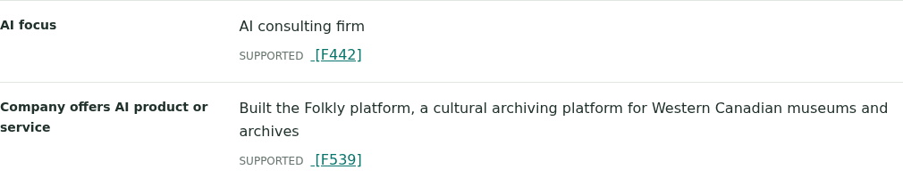

# Canadian AI company discovery

**Find Canadian AI companies. See what they build. Follow the evidence.**

ProjectClarity turned a broad startup research question into an evidence-linked
list of companies, their locations and their AI products and services. It then
followed selected links to expand the findings—all within a bounded workflow.

**[View the three-slide presentation (PDF)](presentation.pdf)** ·
[Browser presentation](presentation.html) · [Full cited report](report.html)

## What it found

> List Canadian technology startups focused on building AI products and/or services.

The saved report includes these concrete examples:

| Company | Canadian location in the evidence | What it builds | Inspect the finding |
|---|---|---|---|
| **BenchSci** | Toronto | Biomedical AI that helps researchers identify antibodies, reagents and experimental discoveries | [Report entry and citations](report.html#entry-6) |
| **Waabi** | Toronto | AI-first autonomous transportation using simulation-driven machine learning | [Report entry and citations](report.html#entry-48) |
| **Cohere** | Toronto | Enterprise language models and generative AI applications | [Report entry and citations](report.html#entry-14) |

These examples show the useful output: company names connected to locations,
offerings and source evidence, ready for a person to inspect and follow up.

## Following a discovery: Folkly → ORKA AI

The initial search encountered **Folkly**, a cultural-archiving platform. Following
its profile supplied evidence connecting it to **ORKA AI**, its Calgary-based
creator, and described the platform's work for Western Canadian museums and archives.
This is evidence of useful autonomous follow-up: moving from a product mention to
its creator. The cited connection does **not** itself establish that Folkly uses AI;
ORKA’s AI consulting description cannot supply that missing product-level evidence.

[Source profile](https://aimagazine.ca/canadian-ai-spotlight/folkly-ai-and-the-quiet-revolution-in-cultural-archiving/)
→ [creator evidence](report.html#evidence-F437)
→ [location evidence](report.html#evidence-F443)
→ [creator–product connection](report.html#evidence-F539)
→ [assembled report entry](report.html#entry-38).

*Actual application screenshot, cropped to the AI-focus and offering fields for
readability. The original “Company offers AI product or service” field label is
not proof that Folkly uses AI. Open the image for the full card, including
qualification fields.
Cards are now the default web report view; a compact table remains optional.*

The article request redirected during the saved run. [Source provenance](PROVENANCE.md)
explains the two URL paths and traces these three facts to the saved document.

## The presentation in three slides

1. **Find Canadian AI companies. See what they build.** BenchSci, Waabi and Cohere
   make the outcome concrete.
2. **Following a product mention identified its creator.** The Folkly-to-ORKA
   connection demonstrates autonomous exploration, not AI-product qualification.
3. **Research that advances itself. Evidence a person can inspect.** Link following,
   citation lineage and bounded processing explain the engineering behind the result.

## The run at a glance

| Measure | Recorded result |
|---|---:|
| Research rounds | 2: initial search, then selected links |
| Documents successfully parsed | 14 |
| Retained extraction fact records | **1,221**: 401 in round one, 820 in round two |
| Facts in the combined report evidence | 549 |
| Original report rows | 49 |

The second round contributed 229 report-evidence facts. Extraction counts describe
retained source-scoped assertions; report rows can include aliases and incomplete
candidates. Neither is a count of independently verified companies.

The **[evaluation and methodology](EVALUATION.md)** contains the full round-by-round
measurements, model usage, successful examples, qualification gaps and lessons
learned. This overview and the presentation focus on the discoveries; the audit
keeps the results inspectable without treating every candidate as fully qualified.

## Explore the files

| File | Purpose |
|---|---|
| [presentation.pdf](presentation.pdf) | Three-slide recruiter-facing presentation |
| [presentation.html](presentation.html) | Browser version of the same presentation |
| [report.html](report.html) | All 49 original report entries, with linked evidence |
| [EVALUATION.md](EVALUATION.md) | Detailed evaluation, counting methods and publication notes |
| [metrics.json](metrics.json) | Audited run measurements and original report hash |
| [PROVENANCE.md](PROVENANCE.md) | Requested/final URL distinction and saved-document trace |
| [provenance.json](provenance.json) | Redirect receipt metadata and fact-to-chunk hashes |
| [sources.json](sources.json) | Attempted source URLs, outcomes and extraction counts |
| [report.json](report.json) | Original answer fields plus exported assertion text and source links |
| [Full card screenshot](assets/report-orka-card.png) | Actual current UI showing the saved ORKA finding |
| [Evidence excerpt](assets/report-orka-evidence.png) | Labelled crop used in the presentation |

**No API key is needed to inspect these artifacts.** GitHub displays the Markdown,
images and PDF. To view the HTML locally, download this folder with its `assets/`
subfolder intact, then open `presentation.html` or `report.html` in a browser.
No server or external JavaScript is required. Live source links require internet
access; the presentation's links to saved evidence work locally.

The report data is unchanged by the presentation or the card-view update. This is
a saved example of autonomous collection and assembly **for human review**.
